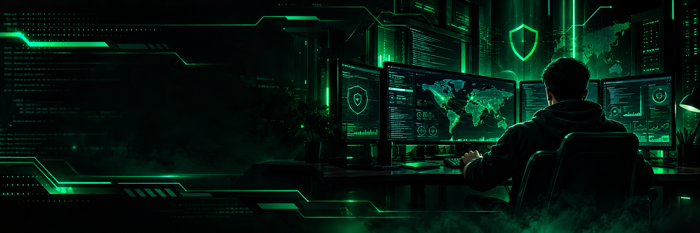

<!-- Cybersecurity Banner -->

  

<h1 align="center">👋 Hi, I'm Belal</h1>

  <b>SOFTWARE ENGINEERING</b> ·
  <b>CYBERSECURITY</b> ·
  <b>ARTIFICIAL INTELLIGENCE</b>

  
  
  

---

## 🟢 `01 // WHO AM I`

I'm a Computer and Information Science student at **Mansoura University**, interested in software engineering, cybersecurity, and artificial intelligence.

I enjoy learning through practical projects, technical labs, and continuous experimentation.

- 🎓 Software Engineering student
- 💻 Interested in building software applications
- 🛡️ Exploring network security and security monitoring
- 🤖 Developing my knowledge of artificial intelligence

---

## 💻 `02 // TECH STACK`

### Software Engineering

  
  
  
  
  

### Cybersecurity & Networking

  
  
  
  
  

### Artificial Intelligence

  
  

*Currently exploring artificial intelligence concepts and practical applications.*

---

## 🚀 `03 // FEATURED PROJECTS`

<table>
  <tr>
    <td width="60%" valign="top">

### 🚗 CarHub

**Car Information & Comparison Platform**

A web application project for browsing car information, comparing vehicle specifications, and managing car data.

**Technologies**

  
  
  
  
  
  

**Project Focus**
- Car listings and details
- Vehicle specification comparison
- Backend API and database integration

[**View CarHub Repository →**](https://github.com/Eslamali131/CarHub)

</td>
<td width="40%" valign="top">

### 🛡️ SOCVision

**Cybersecurity Project**

Currently in development.

[**View Repository →**](https://github.com/Eslamali131/SOCVision)

</td>
</tr>
</table>

---

## 🛡️ `04 // TRAINING`

### ITIDA & NTI — Network Security Training

  
  

- Networking and CCNA fundamentals
- Wireshark and network traffic analysis
- Security monitoring concepts and tools, including Splunk, Kibana, and Sguil
- Network security, vulnerability awareness, and incident analysis

---

## 🎯 `05 // CURRENT FOCUS`

- Improving software engineering skills
- Practicing networking and cybersecurity labs
- Exploring artificial intelligence concepts
- Building and documenting practical projects

---

  
  
  

  <i>Learning every day. Building one project at a time. 💚</i>

